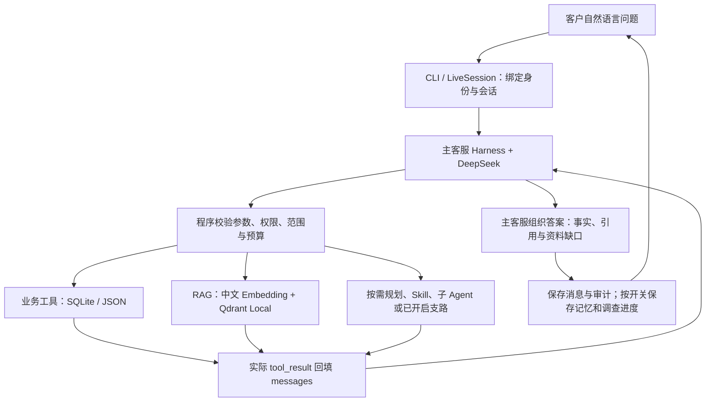

# E-commerce Agent

一个以电商客服为场景的 Python Agent 工程实践：通过工具查询模拟订单、商品和物流，检索本地中文知识库，并在可选的规划、子 Agent、记忆与任务机制支持下完成多轮咨询。

**本地 CLI 原型 · 全部业务资料为模拟数据 · 支持真实 DeepSeek 接入**

项目参考 [Learn Claude Code](https://github.com/shareAI-lab/learn-claude-code) 的 Agent 基础机制，结合电商场景进行工程适配，使用 AI 辅助开发与调试。它用于学习和作品集展示；目前没有真实商家上线或生产业务指标。

## 可以体验什么

- **自然语言选工具**：用户直接提问，主 Agent 根据需求调用受控工具，再根据实际结果回答。
- **订单与商品事实查询**：SQLite 保存历史成交数据，JSON 提供政策和模拟物流；订单归属由程序校验。
- **中文向量 RAG**：FastEmbed + Qdrant Local 检索公开资料，返回原文、来源、版本和片段 ID。
- **有边界的协作**：当前回合 Todo、按需加载 Skill、隔离上下文的子 Agent，以及可选的持续队友。
- **多轮接续**：可选的长期记忆、持久调查任务、后台物流查询、每日查询安排。
- **过程可检查**：工具前后 Hooks、消息存盘、调用事件、上下文归档和受控原文查回。

业务工具均为只读查询。项目尚未接入真实商家 API、退款执行或售后单创建，也没有 Web 前端。记忆与任务写入的是本地辅助状态。

## 一次查询怎样完成



模型提出工具请求，程序执行权限和参数检查；工具结果回填后，模型才能继续推理。主客服负责最终回答。简单问题不强制规划或委派，多个调用也不自动等于并行执行。

[完整功能链条与代码导航](docs/architecture.md) · [RAG 设计与漏召回优化](docs/rag.md) · [验证方法与结果边界](docs/verification.md)

## 快速开始

已验证环境：**Windows + Python 3.12**。以下先运行不需要聊天 API key 的离线示例。

```powershell
git clone https://github.com/rkwu52468-hue/E-commerce-Agent.git
cd E-commerce-Agent
python -m venv .venv
.\.venv\Scripts\Activate.ps1
python -m pip install -r requirements.txt
python app.py --demo-sqlite
```

若 PowerShell 限制激活脚本，可直接用 `.\.venv\Scripts\python.exe` 替代命令中的 `python`。Linux/macOS 可使用 `source .venv/bin/activate`，但本项目尚未在这些系统验证。

离线示例使用真实 SQLite 引擎和脚本模型，演示：

- P100 商品当前标价 **199 元**。
- Alice 的 A1001 历史订单实付 **169 元**。
- 查询其他客户订单时被拒绝。

脚本回答不代表真实大模型生成。无需为了演示创建本地登录密码。

### 启用本地向量知识库

在同一个虚拟环境中安装可选依赖：

```powershell
python -m pip install -r requirements-rag.txt
python -m customer_service.knowledge_cli build
python -m customer_service.knowledge_cli search "P100杯子能拿钢丝球刷吗？平时怎么洗，洗完怎么放？"
```

首次构建会下载中文 Embedding 模型，需要网络和本地磁盘空间；检索在本机运行，不调用聊天模型。默认模型缓存位于项目 `.cache/fastembed`，可通过当前进程环境变量 `FASTEMBED_CACHE_PATH` 指定其他位置。生成的索引保存在 `runtime/knowledge_demo`，不上传仓库。

当前模拟语料包含 **27 条记录，其中 22 篇有效公开资料、66 个片段**；其余记录用于过期、未生效、他店或私有资料过滤检查。这里的“公开”指应用内可检索范围，所有记录本身均为合成测试资料。

### 接入真实 DeepSeek

`config.json` 保存模型名称和 Anthropic 兼容接口地址，不保存密钥。启动：

```powershell
python app.py --live --allow-knowledge
```

程序会隐藏提示输入 API key；也可从当前进程 `DEEPSEEK_API_KEY` 读取。不会自动加载 `.env`。真实模型请求会产生相应 API 用量，模型可用性以自己的账号为准。

访客状态可直接测试公开知识问题：

> P100这款保温杯脏了，能拿钢丝球刷吗？平时应该怎么洗，洗完怎么放？

预期观察到 `get_product` / `search_knowledge` 等实际调用，并回答温水、少量中性洗涤剂、柔软杯刷、充分冲净、分开放置晾干等有原文依据的内容。具体调用顺序由模型决定。

### 测试登录后的订单 + RAG

首次为本地模拟 Alice 账号设置密码：

```powershell
python app.py --init-auth --customer alice
python app.py --live --allow-knowledge
```

按提示设置 **15–128 字符**的本地密码；进入会话后输入 `/login` 并按提示登录 Alice。密码验证由本地程序处理，凭据不进入模型。然后自然提问：

> 帮我查一下 A1001 实际付了多少钱，再告诉我这个订单里的保温杯应该怎么洗、能不能用钢丝球刷。

应将 **订单实付 169 元**与**商品现价 199 元**分开说明，并引用检索到的清洗原文。工具未提供优惠、折扣、运费等明细时，金额差异的原因仍然未知。

再测试资料缺口：

> 假如收到杯子后拆开包装但没有使用，是不是一定能退？我只是在假设，并没有说已经收货。

应说明现有申请条件和人工审核要求，明确“拆封是否影响资格”的缺口，并保留用户的假设语气。

`/help` 查看本地命令，`/logout` 退出身份，`q` 或 `exit` 结束程序。登录会建立新上下文，不会自动加载旧聊天记录。

## 能力开关

| 能力 | 启动方式 / 条件 |
| --- | --- |
| 主循环、只读商店工具、Hooks、Todo、Skill、一次性子 Agent、基本上下文整理 | 普通 `--live` 默认具备；私人查询需登录 |
| 中文知识库 | `--allow-knowledge`；先构建索引 |
| 自动 / 主动 / 上下文溢出摘要 | `--allow-summary` |
| 四类长期记忆 | `--allow-memory` + 登录 |
| 持久调查任务 | `--allow-tasks` + 登录 |
| 后台物流查询 | `--allow-background` + 登录 |
| 每日物流查询安排 | `--allow-schedules` + 登录；CLI 需要保持运行 |
| 持续物流 / 政策队友 | `--allow-teams` + 登录 |

开关可以组合，登录本身不会开启可选能力。初次体验建议只开启 RAG，再分别验证其他机制。额外机制可能增加模型请求量。

Windows 快捷入口：`run.cmd --demo-sqlite`、`run-rag.cmd build`、`run-rag.cmd live`。脚本使用本项目 `.venv` / `.venv-rag`；`run-rag.cmd live` 不接受附加开关，需要组合能力时使用 Python 直接启动。

## RAG 的实现要点

- 使用 `BAAI/bge-small-zh-v1.5` 生成 **512 维**向量，Qdrant 使用本地模式。
- 最多返回 3 个向量主命中，余弦相似度阈值为 0.5。
- 补充同文档、同版本且有效的相邻原文，最多 3 段；相邻段保留独立引用 ID，`score=null`。
- 主命中和相邻段合并后的规范 JSON 证据限额为 **3000 字符**；这不是全部消息或精确 token 数。
- 保存 source、version、chunk_id 和哈希；原文或模型指纹变化时要求重建索引。
- 私人订单留在鉴权业务工具中，公开知识库不承载私人订单查询。

首次真实清洗问答曾漏掉正向清洗方法，相邻原文补充后已在真实 DeepSeek 手动测试中召回。检索到资料仍需核对适用范围，模型最终回答的语义支持目前主要通过人工核验。

## 验证

```powershell
python -m pip install -r requirements-rag.txt
python -m unittest discover -s tests -v
python -m customer_service.knowledge_cli evaluate
python tools/evaluate_knowledge_context.py
```

后两个命令需先构建索引，只运行本地检索评测。

发布副本于 **2026-11-07** 验证：**493 项离线自动化检查通过，0 失败、0 错误、0 跳过**；SQLite 离线演示、22 篇 / 66 片段索引构建及自然清洗检索均通过。使用已有 Python/RAG 环境和模型缓存，未验证全新安装或空缓存下载。

24 个冻结片段问题中，补充相邻原文后的平均标注证据覆盖从 **75.69% 到 82.64%**，全部预期片段送达从 **14/24 到 17/24**；平均返回片段也从 **3 到 4.54**。这是小型模拟数据上的检索证据覆盖，**不是回答准确率、任务成功率或线上业务收益**。原始会话、密钥、客户状态与运行日志不随仓库发布。更多口径见[验证说明](docs/verification.md)。

## 目录

```text
app.py                         CLI、启动与功能开关
customer_service/
  harness.py                   主 Agent 循环与工具分发
  live_session.py / auth.py    会话和本地身份
  shop.py / storage.py         只读业务查询与 SQLite
  knowledge.py                 向量索引、检索和证据补充
  context.py                   上下文整理与受控查回
  subagent.py / teams.py       一次性子 Agent 与持续队友
  memory.py / task_system.py   长期记忆和持久调查进度
  background.py / scheduler.py 后台查询与每日安排
skills/                        按需加载的调查指南
data/                          合成业务数据和知识评测集
tests/                         离线检查
tools/                         检索证据评测工具
vendor/                        保留来源与许可证的课程代码
docs/                          架构、RAG 和验证说明
runtime/                       本地生成状态（Git 忽略）
```

`requirements-rag.lock.txt` 是已验证 Windows 环境的依赖快照，包含平台专用依赖；常规安装请使用 `requirements-rag.txt`。

## 来源与许可

课程来源为 [shareAI-lab/learn-claude-code](https://github.com/shareAI-lab/learn-claude-code)，参考固定提交 `7226f555d48900076eba126acf37c9ed5f002b5d`。项目保留了上游代码的 [MIT 许可证](vendor/LICENSE.learn-claude-code)和[来源记录](vendor/SOURCE.json)，具体见 [THIRD_PARTY_NOTICES.md](THIRD_PARTY_NOTICES.md)。上游许可只覆盖相应上游内容；本仓库尚未为其余代码单独指定统一许可证。
