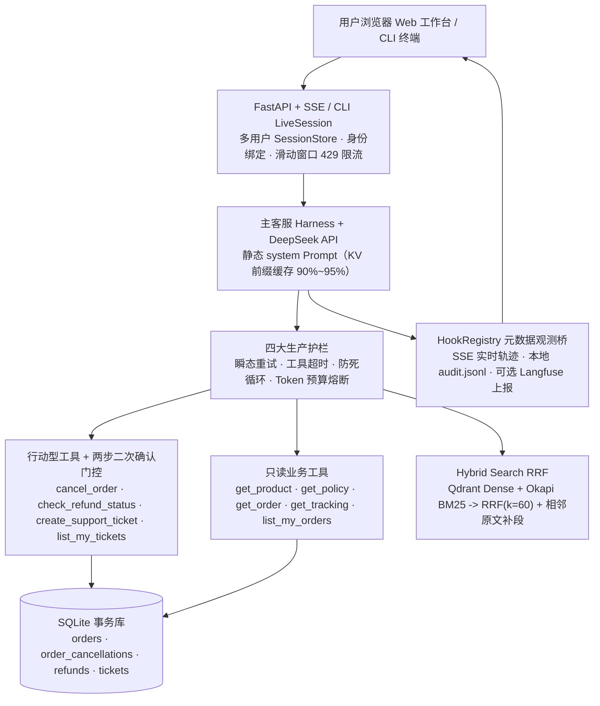

# E-commerce Support Agent (`desk.cs`)

一个**行动型、可审计、可容器化部署**的电商智能售后 Agent 系统：在真实 SQLite 事务读写、两步高危确认门控、Hybrid Search（Qdrant 向量 + Okapi BM25 RRF 融合）、四大生产护栏与静态 KV 前缀缓存优化的基础上，提供 FastAPI + SSE 实时 Web 工作台与 100 题端到端真模型评测体系。

**FastAPI + SSE Web 工作台 & CLI 双入口 · 真实 SQLite 事务读写 · 真实 DeepSeek 100 题实测 · Docker / 魔搭创空间已上线**

- **公网在线体验（魔搭创空间 Docker 实测部署）**：https://modelscope.cn/studios/MamaoOvo/ecommerce-support-agent

> 工程诚实口径：全部订单、商品、退款与知识库资料均为本地模拟数据，不代表真实商家生产上线指标。下文所有自动化测试项数、本地检索指标、缓存优化对比、真实 DeepSeek 100 题评测与云端 Docker 部署记录均严格分栏记录，详见 [docs/verification.md](docs/verification.md)。

---

## 核心亮点与实测指标

| 工程维度 | 实现方案 | 真实可复现实测结果（2026-11-26 ~ 27） |
| --- | --- | --- |
| **行动型业务闭环** | SQLite `BEGIN IMMEDIATE` 事务读写、订单取消状态机、高危写操作**两步二次确认门控**（禁止模型同回合自批）、自动原路退款单、人工升级工单与去重 | `action_execution` 20/20 (**100%**)；SQLite 终态准确率 **100/100**；离线行动演示 **15/15** |
| **Hybrid Search RRF** | Qdrant Dense（`BAAI/bge-small-zh-v1.5`, Top-10）+ 归一化 Okapi BM25（CJK bigram + ASCII 编码词, Top-10）→ `RRF(k=60)` Top-3 + 一跳相邻补段（3000 字符上限） | Holdout Recall@3 **`0.8125 → 0.9375` (+12.5pp)**，MRR@3 **`0.7847 → 0.8958` (+11.1pp)**；24 题多段证据覆盖 **`75.69% → 86.11%`**（+2.18 ms） |
| **Prompt Cache 极致优化** | 消除动态 `<pending_confirmations>` 与 `<current_todos>` 对 `system` Prompt 的 KV 前缀击穿，全部动态状态改为最新 `user` 消息尾部 append-only 注入 | Alice 4 轮实测缓存命中率 **`71.8% → 95.1%`**（未命中输入 **`-82.6%`**）；延误升级单轮 **`50.7% → 89.1%`**（未命中输入 **`-90.9%`**） |
| **四大生产护栏** | 瞬态错误指数退避重试（429/5xx）、单工具超时隔离（`TOOL_TIMEOUT`）、防重复/连续失败死循环熔断、单轮/会话/跨重启每日 Token 预算熔断 + HTTP `429` 滑动窗口限流 | 100 题真模型评测中 3 道真实工具超时题 **3/3 自动转人工且 0 幻觉**；无误熔断 |
| **100 题真模型 E2E 评测** | 5 大类 × 20 题（常规查询 / 行动执行 / RAG / 安全越权与注入 / 异常升级），支持 `--mode offline` 与真实 DeepSeek `--mode live` 断点续跑 | 严格自动评分：**工具 98.0%、DB 终态 100%、人工升级 100%/100%、严格解决率 95.0%**（5 题误判人工复核后 0 真实业务/幻觉错误）；整体缓存命中 **90.35%**，全量 100 题总费用 **≈ ¥0.62** |
| **Web 工作台与观测** | FastAPI + SSE 实时流式推送（`tool_start/tool_end/delta/state`）、`exe.dev` 纸面手册 + 深色精密仪表 UI、可视化二次确认按钮、右侧实时订单/退款/工单看板、可选 Langfuse Hook | 全量 `unittest` **519/519 通过**（0 失败 / 错误 / 跳过）；真实 Uvicorn HTTP/SSE 探活通过 |

---

## 系统架构



深入阅读：[系统架构与模块导航](docs/architecture.md) · [RAG 设计与检索优化](docs/rag.md) · [完整实测验证报告](docs/verification.md) · [云端与 Docker 部署指南](docs/deployment.md)

---

## 快速开始

### 1. 安装依赖与构建本地 Hybrid RAG 索引

已验证环境：**Windows 11 + Python 3.12**（Docker 镜像基于 `python:3.12-slim`）。

```powershell
git clone https://github.com/rkwu52468-hue/E-commerce-Agent.git
cd E-commerce-Agent
python -m venv .venv
.\.venv\Scripts\Activate.ps1

# 安装完整依赖（核心 + Hybrid RAG + FastAPI Web）
python -m pip install -r requirements-rag.txt -r requirements-web.txt

# 构建本地 Qdrant + 中文向量索引（约 22 篇有效公开资料 / 66 片段，不调用聊天 API）
python -m customer_service.knowledge_cli build
```

> 首次构建会自动下载 `BAAI/bge-small-zh-v1.5`；可通过 `FASTEMBED_CACHE_PATH` 环境变量复用本机已有模型缓存。

### 2. 启动 Web 客服工作台（推荐首选体验）

```powershell
# 方式 A：零 API 费用直接体验 UI、SSE 流式、SQLite 取消确认与 Hybrid RAG
python web_server.py --mode demo --port 8000

# 方式 B：接入真实 DeepSeek API（未设置环境变量时启动会隐藏提示输入 Key）
$env:DEEPSEEK_API_KEY = "sk-你的密钥"
python web_server.py --mode live --port 8000
```

打开浏览器访问 **`http://127.0.0.1:8000`**：
1. 访客状态体验公开商品问价、取消规则与 Hybrid RAG 清洗禁忌；
2. 左侧一键切换 `alice` / `bob` / `charlie` 查看实时 SQLite 订单账本，验证跨客户访问 `B2001` 拦截；
3. 点击「取消未发货的 A1003」，体验**可视化两步二次确认门控** → 点击确认后实时观测 `A1003` 变为 `cancelled` 并自动生成原路退款单 `RF-A1003`；
4. 点击「A1001 延误核实 + 人工升级」，在右侧 `REFUND/TK`、`TRACE` 与底部 Prompt Cache 预算条中实时观察工单落库与缓存命中率。

### 3. Docker / 云端一键部署

```bash
cp .env.example .env
# 在 .env 中填入 DEEPSEEK_API_KEY（留空则自动以零成本 demo 模式运行）
docker compose up -d --build
```

同样支持 **魔搭社区 ModelScope 创空间（免费 Docker 2vCPU / 8GB，已实测部署）**、**Render / Google Cloud Run / ECS** 与 **Hugging Face Spaces（PRO Docker SDK，端口 7860）**，完整步骤见 [docs/deployment.md](docs/deployment.md)。

### 4. CLI 命令行模式与离线演示

```powershell
# 零 API 行动型客服全套演示（15 项检查：状态机、两步确认、退款、工单、四大护栏）
python app.py --demo-actions

# 首次为 CLI 模拟账号配置本地密码（15-128 字符，密码不发给模型）
python app.py --init-auth --customer alice

# 启动真实 DeepSeek 行动型 + Hybrid RAG CLI 会话（支持 /login /confirm /reject /tickets /budget）
python app.py --live --allow-actions --allow-knowledge
```

---

## 复现评测与自动化测试

```powershell
# 1) 全量回归测试（519 项：身份、SQLite 事务、两步确认、四大护栏、Hybrid RAG、Web SSE/429/Langfuse、容器配置）
python -m unittest discover -s tests -v

# 2) Hybrid Search RRF vs Dense 真实本地检索对比（0 聊天 API）
python -m customer_service.knowledge_cli evaluate
python tools/evaluate_knowledge_context.py --mode dense
python tools/evaluate_knowledge_context.py --mode hybrid

# 3) 100 题端到端 Agent 评测（先 0 API 管道校验，再按需跑真实 DeepSeek）
python tools/evaluate_agent_e2e.py --mode offline --retrieval-mode hybrid
python tools/evaluate_agent_e2e.py --mode live --retrieval-mode hybrid --limit 15
# 全量 100 题（约 ¥0.62，支持 --resume 断点续跑）：
python tools/evaluate_agent_e2e.py --mode live --retrieval-mode hybrid --daily-token-budget 3000000
```

---

## 目录结构

```text
app.py                         CLI 入口（只读/行动模式、本地 /login /confirm /budget 等开关）
web_server.py                  FastAPI + SSE Web 服务入口（支持 CLI 参数与容器环境变量）
Dockerfile / docker-compose.yml / .env.example   容器化与云端部署配置
web/                           exe.dev 风格纸面手册 + 深色精密仪表 Web 工作台（HTML/CSS/JS）
customer_service/
  harness.py                   主 Agent 循环、静态 Prompt Cache 管理、工具分发与两步确认门控
  shop.py / storage.py         业务工具与 SQLite 事务读写（orders / cancellations / refunds / tickets）
  safeguards.py                四大生产护栏（瞬态重试、超时、防死循环、缓存感知 Token 预算熔断）
  knowledge.py / knowledge_cli.py  Qdrant Dense + Okapi BM25 RRF 混合检索与一跳相邻原文补段
  web_app.py / web_sessions.py FastAPI SSE 接口、多用户 SessionStore、滑动窗口限流、演示模型
  observability.py             HookRegistry 元数据观测桥、SSE 实时事件流与可选 Langfuse 上报
  live_session.py / auth.py    会话隔离与本地凭据验证
  context.py / subagent.py / teams.py / memory.py / task_system.py / background.py / scheduler.py
data/
  shop-action-seed.json        扩展模拟商店种子（3 客户 / 6 SKU / 4 政策 / 12 多态订单 / 退款 / 工单）
  knowledge_demo/              公开知识库语料与冻结检索评测集
  eval_agent_100.json          5 大类 × 20 题端到端 Agent 评测集
tools/                         Hybrid RAG 评测器、100 题 E2E 评测器、Prompt Cache 对比脚本
tests/                         519 项自动化回归与验收测试
docs/                          架构、RAG、实测验证口径与云部署指南
```

---

## 来源与许可

基础 Agent 循环教学原型参考 [shareAI-lab/learn-claude-code](https://github.com/shareAI-lab/learn-claude-code)（固定提交 `7226f555d48900076eba126acf37c9ed5f002b5d`），保留上游 [MIT 许可证](vendor/LICENSE.learn-claude-code)与[来源记录](vendor/SOURCE.json)，详见 [THIRD_PARTY_NOTICES.md](THIRD_PARTY_NOTICES.md)。Web 工作台前端视觉灵感参考 `exe.dev` 2026 纸面技术手册与深色仪器风格。
